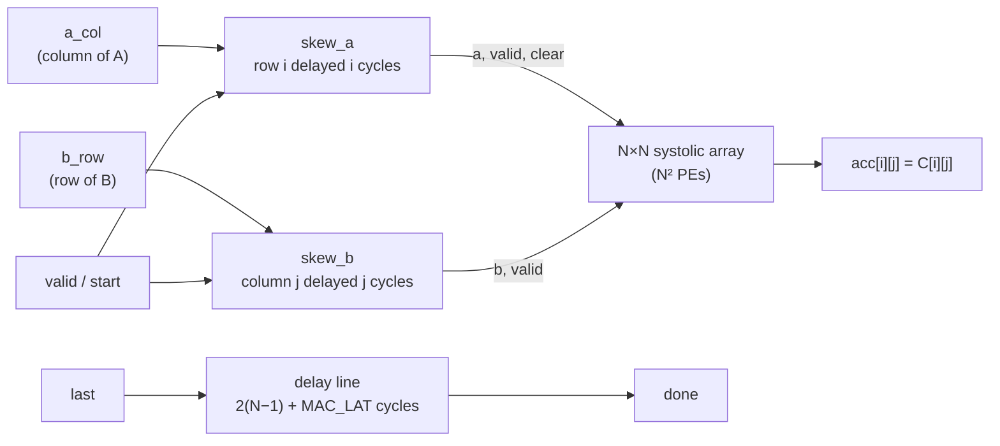
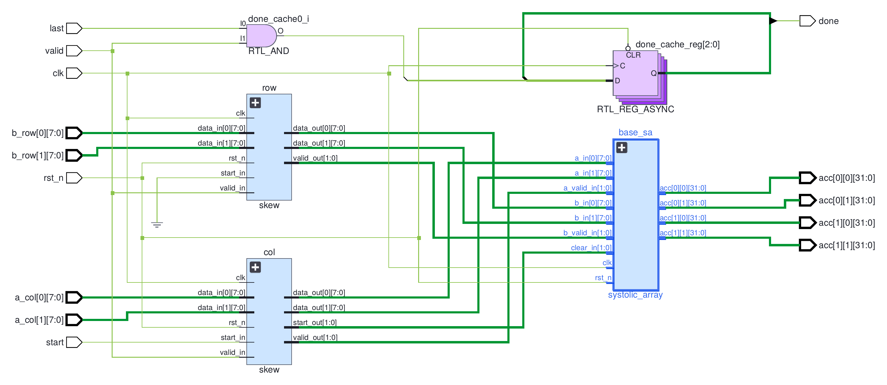
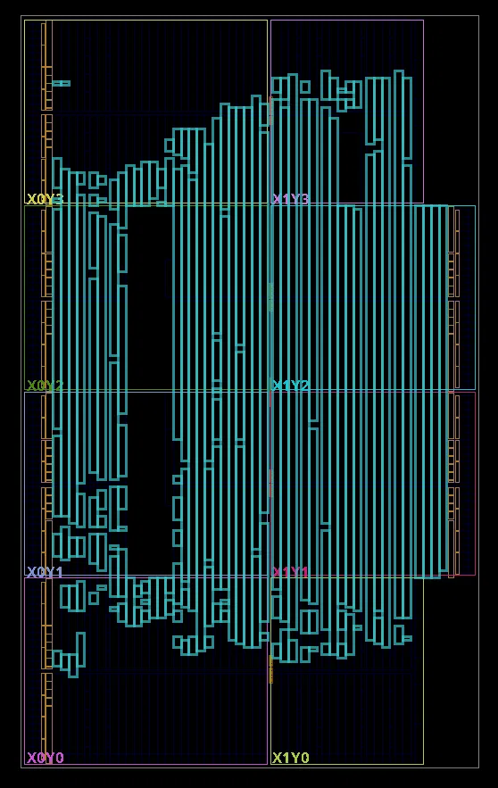

# ai-rtl: int8 Systolic Array Matrix Multiplier

A parameterised **N×N output-stationary systolic array** in SystemVerilog that computes **C = A × B** on signed 8-bit inputs with 32-bit accumulators, the core operation of neural-network accelerators such as Google's TPU.

You feed plain matrices one column of A and one row of B per cycle; the hardware skews the inputs, streams them through N² multiply-accumulate units, and raises `done` the cycle the result is ready. Two MAC designs are selectable with one parameter: a single-cycle MAC built from logic, and a two-stage pipelined MAC that maps onto one DSP48E1 per PE.

On an AMD Artix-7 the pipelined array holds **above 220 MHz up to N = 15** (225 PEs, about **99 GOPS** peak) while using **under 150 LUTs**, compared with 114 MHz and 33,371 LUTs for the single-cycle version at N = 16. Everything is verified in simulation for N = 2 to 8 with random data, varying matrix lengths, idle cycles in the input stream and back-to-back matrices, for both MAC designs.

## Block diagram



Inside the array, `a` values move right and `b` values move down, one PE per cycle. Each PE multiplies the pair passing through it and keeps its own running sum:

```
            b[0]       b[1]       b[2]       b[3]
             ▼          ▼          ▼          ▼
a[0] ──►  PE(0,0) ──► PE(0,1) ──► PE(0,2) ──► PE(0,3)
             ▼          ▼          ▼          ▼
a[1] ──►  PE(1,0) ──► PE(1,1) ──► PE(1,2) ──► PE(1,3)
             ▼          ▼          ▼          ▼
a[2] ──►  PE(2,0) ──► PE(2,1) ──► PE(2,2) ──► PE(2,3)
             ▼          ▼          ▼          ▼
a[3] ──►  PE(3,0) ──► PE(3,1) ──► PE(3,2) ──► PE(3,3)

PE(i,j) accumulates C[i][j] = Σk A[i][k] · B[k][j]
```

## Features

- **Parameterised size N** (tested N = 2, 3, 4, 8), built with `generate` loops
- **Two MAC designs, one parameter:** `MAC_LAT = 1` (single-cycle) or `MAC_LAT = 2` (pipelined, one DSP48 per PE); the `done` timing follows automatically
- **Any inner dimension K:** an N×N array computes (N×K) × (K×N) for any K; the 32-bit accumulator has headroom for very long sums
- **Signed int8 × int8 → int32** multiply-accumulate in every PE
- **Hardware input skewing:** the array takes unskewed columns and rows straight from memory
- **Valid signals travel with the data:** idle cycles (bubbles) anywhere in the input are ignored
- **Per-row clear travelling with the data:** matrices can be streamed back to back with no gap
- **`done` signal:** pulses exactly 2(N−1) + MAC_LAT cycles after the last column, on the first cycle all results are final
- **Area-aware registers:** control signals (valid, start, done) have a reset; data registers (skew lanes, forwarded `a` and `b`) do not, since their valid bit marks them as unused

## Top-level interface: `complete_sa`

| Parameter | Default | Description |
| --- | --- | --- |
| `N` | 4 | Array size (N×N PEs) |
| `MAC_LAT` | 2 | MAC latency in cycles: 1 = single-cycle `mac8`, 2 = pipelined `mac8_pipe` |

| Port | Dir | Width | Description |
| --- | --- | --- | --- |
| `clk` | in | 1 | Clock |
| `rst_n` | in | 1 | Reset, active low (hold for at least one clock edge: the pipelined MAC resets synchronously) |
| `a_col` | in | `[N-1:0][7:0]` | Column k of A: `a_col[i] = A[i][k]` |
| `b_row` | in | `[N-1:0][7:0]` | Row k of B: `b_row[j] = B[k][j]` |
| `valid` | in | 1 | This cycle's column/row is real data |
| `start` | in | 1 | First column of a new matrix (starts fresh sums) |
| `last` | in | 1 | Last column of the matrix |
| `done` | out | 1 | One-cycle pulse when every result is final |
| `acc` | out | `[N-1:0][N-1:0][31:0]` | `acc[i][j] = C[i][j]` (signed) |

**Usage:** on each cycle, drive one column of A and the matching row of B with `valid = 1`. Set `start = 1` on the first column and `last = 1` on the last (both on the same cycle if K = 1). Wait for `done`, then read `acc`.

## How it works

**Dataflow (output-stationary).** Each PE keeps one element of C. Row i of A enters from the left and moves right; column j of B enters from the top and moves down. Every PE forwards its inputs to its neighbours through registers, one cycle per hop.

**Skewing.** Data reaching PE(i,j) has passed through j PEs horizontally and i PEs vertically, so the `a` and `b` paths have different delays. To line them up, row i of A enters i cycles late and column j of B enters j cycles late. Both then reach PE(i,j) after i + j cycles, so the k-th product happens on cycle **k + i + j**. The skew module implements this with shift registers: lane i has exactly i registers, N(N−1)/2 per side.

For N = 2, the inputs reaching the array look like this:

| Cycle | Row 0 | Row 1 | Column 0 | Column 1 |
| --- | --- | --- | --- | --- |
| 0 | A00 | – | B00 | – |
| 1 | A01 | A10 | B10 | B01 |
| 2 | – | A11 | – | B11 |

**Valid and clear.** Each value carries a valid bit; a PE only accumulates when both its inputs are valid, so empty slots in the skew pattern and idle cycles in the input are ignored. The `start` signal is skewed into one clear per row and travels right with `a`, so it reaches PE(i,j) exactly when that PE's first product of a new matrix arrives (clear-and-load in one cycle). A single global clear would instead force a pause between matrices.

**Timing.** For a matrix with K columns fed on cycles 0 … K−1:

| Quantity | Value |
| --- | --- |
| `done` after the last column | 2(N−1) + MAC_LAT cycles = (N−1) skew + (N−1) PE hops + MAC latency |
| First column to `done` | K + 2(N−1) + MAC_LAT − 1 cycles |
| Peak throughput | N² multiply-accumulates per cycle (both MAC designs) |

The pipelined MAC adds its extra cycle **once**, not once per PE: `a` and `b` reach the next PE through the PE's forwarding registers, not through the MAC, so the MAC's latency only delays each PE's own result.

## The two MACs

**`mac8` (MAC_LAT = 1):** multiply and accumulate in one cycle. Simple, but the critical path is input register → 8×8 multiplier → 32-bit adder at every array size.

**`mac8_pipe` (MAC_LAT = 2):** two stages, written so Vivado maps the whole MAC into one DSP48E1 (product in the M register, sum in the P register):

1. **Stage 1:** `prod <= a × b`, or **0** when the input is invalid or in reset. `clear1` is the clear delayed by one cycle.
2. **Stage 2:** `acc <= prod` when `clear1` is set, otherwise `acc <= acc + prod`.

Forcing invalid products to zero collapses the four cases (load, clear, add, hold) into two (load or add), since adding 0 is the same as holding. Stage 2 therefore depends on a single register bit, `clear1`, which drives the DSP's OPMODE pin with no logic in between. All resets are synchronous, as the DSP's internal registers require, and `clear1` carries a `keep` attribute so synthesis keeps one copy per PE (see the timing results below).

## Modules

| File | Module | Description |
| --- | --- | --- |
| [`rtl/mac.sv`](rtl/mac.sv) | `mac8`, `mac8_pipe` | Single-cycle MAC, and the two-stage pipelined MAC for DSP48 mapping |
| [`rtl/pe.sv`](rtl/pe.sv) | `pe8` | Processing element: selects the MAC with `MAC_LAT`, plus registers that forward a, b, valid and clear |
| [`rtl/sa2x2.sv`](rtl/sa2x2.sv) | `sa2x2` | 2×2 array wired by hand (first step towards N×N) |
| [`rtl/saNxN.sv`](rtl/saNxN.sv) | `systolic_array` | Parameterised N×N array built with nested `generate` loops |
| [`rtl/skew.sv`](rtl/skew.sv) | `skew` | Input skewing: lane i delayed by i cycles, with valid and start |
| [`rtl/sa_top.sv`](rtl/sa_top.sv) | `complete_sa` | Top level: two skew modules, the array and the `done` delay line |

## Verification

Every testbench is self-checking: it computes the expected result with a reference model in the testbench and prints PASS or FAIL. Results with Icarus Verilog 12:

| Testbench | Covers | Result |
| --- | --- | --- |
| [`tb/tb_mac.sv`](tb/tb_mac.sv) | Directed accumulate test (`mac8`) | PASS |
| [`tb/tb_pe.sv`](tb/tb_pe.sv) | Reset, forwarding, valid gating, 5,000 random cycles; reference model delayed by the MAC latency | PASS for MAC_LAT = 1 and 2 (5,011 / 5,012 checks) |
| [`tb/tb_sa2x2.sv`](tb/tb_sa2x2.sv) | 6 directed matrices + 1,000 random, skew done in the testbench | PASS (1,006 multiplications) |
| [`tb/tb_asNxN.sv`](tb/tb_asNxN.sv) | Identity, K = 1, extreme values, back-to-back, 500 random with varying K | PASS at N = 2, 3, 4, 8 (555 multiplications each) |
| [`tb/tb_skew.sv`](tb/tb_skew.sv) | Reset with inputs active, counting pattern, 2,000 random cycles | PASS at N = 2, 3, 4, 8 (up to 16,104 checks) |
| [`tb/tb_sa_top.sv`](tb/tb_sa_top.sv) | Full chain from unskewed input: directed, bubbles with junk data, back-to-back, 500 random; exact `done` timing | PASS at N = 2, 3, 4, 8 for MAC_LAT = 1 and 2 (605 multiplications each) |

Each testbench was also checked against deliberately broken designs (wrong wiring, missing reset, misaligned valid, clear not travelling with the data, `done` one cycle late, and for the pipelined MAC: using `clear` instead of `clear1`, a stuck valid, a product register without reset) to make sure it catches real bugs.

## Running the tests

Requires [Icarus Verilog](https://steveicarus.github.io/iverilog/) 12 or newer. From the repository root:

```bash
# Full system (skew + array + done), pipelined MAC
iverilog -g2012 -Ptb_complete_sa.MAC_LAT=2 -o sim.vvp rtl/mac.sv rtl/pe.sv rtl/saNxN.sv rtl/skew.sv rtl/sa_top.sv tb/tb_sa_top.sv
vvp sim.vvp

# Individual blocks
iverilog -g2012 -o sim.vvp rtl/mac.sv tb/tb_mac.sv && vvp sim.vvp
iverilog -g2012 -Ptb_pe8.MAC_LAT=2 -o sim.vvp rtl/mac.sv rtl/pe.sv tb/tb_pe.sv && vvp sim.vvp
iverilog -g2012 -o sim.vvp rtl/mac.sv rtl/pe.sv rtl/sa2x2.sv tb/tb_sa2x2.sv && vvp sim.vvp
iverilog -g2012 -o sim.vvp rtl/mac.sv rtl/pe.sv rtl/saNxN.sv tb/tb_asNxN.sv && vvp sim.vvp
iverilog -g2012 -o sim.vvp rtl/skew.sv tb/tb_skew.sv && vvp sim.vvp
```

Other sizes, MAC designs and random seeds:

```bash
iverilog -g2012 -Ptb_complete_sa.N=8 -Ptb_complete_sa.MAC_LAT=1 -o sim.vvp rtl/*.sv tb/tb_sa_top.sv
vvp sim.vvp +seed=42
```

## Synthesis results

The same RTL was synthesised, placed and routed for two FPGAs with two toolflows: **AMD Artix-7** with **Vivado**, and **Lattice ECP5** with the open-source **sv2v + Yosys + nextpnr** flow. Max clock comes from static timing analysis after place and route. Peak throughput = 2 operations (multiply + add) × N² PEs × max clock.

**Summary (Artix-7 XC7A100T):**

| N | PEs | Single-cycle MAC (LUTs) | Pipelined MAC (DSP48) |
| --- | --- | --- | --- |
| 2 | 4 | 530 LUTs, 128 MHz, 1.0 GOPS | 6 LUTs + 4 DSPs, 297 MHz, 2.4 GOPS |
| 4 | 16 | 2,098 LUTs, 122 MHz, 3.9 GOPS | 11 LUTs + 16 DSPs, 282 MHz, 9.0 GOPS |
| 8 | 64 | 8,424 LUTs, 121 MHz, 15.5 GOPS | 47 LUTs + 64 DSPs, 256 MHz, 32.8 GOPS |
| 12 | 144 | 18,821 LUTs, 117 MHz, 33.7 GOPS | 102 LUTs + 144 DSPs, 233 MHz, 67.0 GOPS |
| 15 | 225 | – | 147 LUTs + 225 DSPs, 221 MHz, 99.4 GOPS |
| 16 | 256 | 33,371 LUTs, 114 MHz, 58.3 GOPS | 1,685 LUTs + 240 DSPs, 189 MHz, 96.8 GOPS |

### AMD Artix-7 (Vivado)

Target: **XC7A100T-1CSG324** (63,400 LUTs, 126,800 flip-flops, 240 DSP48E1 slices), the FPGA on the Nexys A7-100T and Arty A7-100T boards. `complete_sa` was synthesised out of context (`-mode out_of_context`, so its ports need no FPGA pins) with Vivado's default synthesis and implementation strategies and a 5 ns clock constraint ([`synth/timing.xdc`](synth/timing.xdc)); the maximum clock is 1 / (5 ns − WNS).

#### Single-cycle MAC (`MAC_LAT = 1`, LUT multipliers)

| N | PEs | LUTs | % of chip | LUTRAM | Flip-flops | DSPs | WNS at 5 ns | Max clock | Power (est.) |
| --- | --- | --- | --- | --- | --- | --- | --- | --- | --- |
| 2 | 4 | 530 | 0.8% | 0 | 185 | 0 | −2.798 ns | 128 MHz | – |
| 4 | 16 | 2,098 | 3.3% | 0 | 820 | 0 | −3.205 ns | 122 MHz | – |
| 8 | 64 | 8,424 | 13% | 32 | 3,265 | 0 | −3.288 ns | 121 MHz | 0.36 W |
| 12 | 144 | 18,821 | 30% | 64 | 7,328 | 0 | −3.544 ns | 117 MHz | 0.71 W |
| 16 | 256 | 33,371 | 53% | 96 | 13,069 | 0 | −3.781 ns | 114 MHz | 1.16 W |

*These runs used the RTL before the `MAC_LAT` refactor; N = 2 was re-run with the current code and gave the same LUT count and clock (530 LUTs, WNS −2.800 ns). With its default settings Vivado builds the 8×8 multipliers from LUTs and carry chains rather than DSP48 slices. Power is Vivado's vectorless estimate at the 5 ns constraint (medium confidence), not a measurement.*

- **Area scales linearly with the number of PEs:** about 125 LUTs per PE, so the size of any array can be predicted before synthesis.
- **The clock barely drops as the array grows:** 128 → 114 MHz (−11%) while the array grows 64×. Every PE only connects to its neighbours, and LUT-based multipliers can sit right next to their PE.
- **The critical path is the single-cycle MAC:** at N = 16 the worst path runs from one PE's `b` forwarding register through the multiplier and the 32-bit adder into the next PE's accumulator. The high accumulator bits are last because the carry ripples up the adder.
- **Unreset delay lines become LUT shift registers:** from N = 8, Vivado packs the longer skew lanes into SRLs, which is why LUTRAM appears. This only works because the skew data registers have no reset.
- **Forcing DSPs on the single-cycle MAC does not help:** with `(* use_dsp = "yes" *)` at N = 2 it uses 202 LUTs, 59 flip-flops and 8 DSPs (two per PE) but runs at only 119 MHz, because multiply and accumulate cannot share one DSP in a single cycle. This motivated the pipelined MAC.

#### Pipelined MAC (`MAC_LAT = 2`, one DSP48E1 per PE)

The pipelined MAC was improved in two steps, each guided by the timing report:

| N | PEs | First version | + zeroed products (OPMODE fix) | + `keep` on `clear1` (final) | Total gain |
| --- | --- | --- | --- | --- | --- |
| 2 | 4 | 226.9 MHz | 285.3 MHz | **297.0 MHz** | +31% |
| 4 | 16 | 223.5 MHz | 265.0 MHz | **281.7 MHz** | +26% |
| 8 | 64 | 215.4 MHz | 231.3 MHz | **256.0 MHz** | +19% |
| 12 | 144 | 203.7 MHz | 221.6 MHz | **232.8 MHz** | +14% |
| 15 | 225 | 202.6 MHz | 218.0 MHz | **220.9 MHz** | +9% |
| 16 | 256 | 192.6 MHz | 193.0 MHz | 189.0 MHz | – (limited by LUT-built MACs) |

Final version in detail:

| N | PEs | LUTs | LUTRAM | Flip-flops | DSPs | WNS at 5 ns | Max clock | Peak throughput | Power (est.) |
| --- | --- | --- | --- | --- | --- | --- | --- | --- | --- |
| 2 | 4 | 6 | 0 | 12 | 4 | +1.633 ns | 297.0 MHz | 2.4 GOPS | 0.09 W |
| 4 | 16 | 11 | 0 | 196 | 16 | +1.450 ns | 281.7 MHz | 9.0 GOPS | 0.12 W |
| 8 | 64 | 47 | 24 | 1,052 | 64 | +1.094 ns | 256.0 MHz | 32.8 GOPS | 0.24 W |
| 12 | 144 | 102 | 56 | 2,436 | 144 | +0.704 ns | 232.8 MHz | 67.0 GOPS | 0.43 W |
| 15 | 225 | 147 | 80 | 3,831 | 225 | +0.473 ns | 220.9 MHz | 99.4 GOPS | 0.63 W |
| 16 | 256 | 1,685 | 88 | 5,400 | 240 | −0.290 ns | 189.0 MHz | 96.8 GOPS | 0.71 W |

*Vivado 2026.1, same settings as above. Results per step: [`results_vivado_mac2_before.csv`](synth/results_vivado_mac2_before.csv), [`results_vivado_mac2_opmodefix.csv`](synth/results_vivado_mac2_opmodefix.csv), [`results_vivado_mac2_keep.csv`](synth/results_vivado_mac2_keep.csv).*

- **About 20× fewer LUTs and roughly twice the clock** of the single-cycle design at every size. Nearly everything lives inside the DSPs, including the multiplier inputs' registers.
- **First version: the DSP's OPMODE pin was the bottleneck.** Every critical path had the same shape: a control register → one LUT → the DSP48E1's OPMODE input, whose setup time (about 2.4 ns) used half the 5 ns cycle. The LUT combined `clear1` and `valid1` to choose between load, clear, add and hold.
- **Step 1, zeroing invalid products:** with only `clear1` left, the LUT disappeared (0 logic levels) and the polarity inversion moved into the DSP (`IS_INVERTED`). +26% at N = 2.
- **Step 2, stopping register merging:** every PE on a diagonal receives the same `start` at the same moment, so their `clear1` registers hold identical values, and Vivado merged them into one register per diagonal. At N = 15 one register drove 11 DSPs with 1.8 ns of wire. A `keep` attribute gives each PE its own copy: up to +11% more. The flip-flop counts match the predicted N² − (2N − 1) extra registers exactly for N = 2 to 12 (1, 9, 49, 121).
- **The DSP count sets the size limit:** N = 15 (225 of 240 DSPs) is the largest all-DSP array. At N = 16 Vivado builds the remaining 16 MACs from LUTs (+1,500 LUTs) and the clock drops below 200 MHz.
- **The 5 ns constraint understates small arrays:** where the slack is large Vivado stops optimising, so the true maximum at small N is higher. A one-off 3 ns run of the first version at N = 2 reached 278 MHz against 227 MHz from the 5 ns run.

Elaborated RTL schematic of `complete_sa` (N = 2) and the placed single-cycle N = 16 design on the chip:





### Lattice ECP5 (open-source flow)

Target: **Lattice ECP5 LFE5U-85F** (83,640 LUTs, 156 hardware 18×18 multipliers). SystemVerilog is converted to Verilog with sv2v, synthesised with Yosys and placed and routed with nextpnr (default router, `--seed 1`, 200 MHz target).

| N | PEs | Max clock: single-cycle | Max clock: pipelined | Speed-up | ECP5 LUTs (both) | ECP5 FFs: single-cycle → pipelined | Multipliers |
| --- | --- | --- | --- | --- | --- | --- | --- |
| 2 | 4 | 96.3 MHz | 139.9 MHz | +45% | 375 | 265 → 336 | 4 |
| 4 | 16 | 82.9 MHz | 117.4 MHz | +42% | 1,259 | 761 → 1,033 | 16 |
| 8 | 64 | 61.5 MHz | 93.4 MHz | +52% | 5,235 | 2,521 → 3,577 | 64 |
| 12 | 144 | 48.3 MHz | did not route | – | 11,483 | 5,305 → – | 144 |

*Results: [`results_mac1.csv`](synth/results_mac1.csv), [`results_mac2.csv`](synth/results_mac2.csv). The pipelined ECP5 numbers were measured with the first version of `mac8_pipe`; the later changes target Vivado's DSP48 mapping. Tools: Yosys and nextpnr-ecp5 0.9 from OSS CAD Suite; other versions and settings give different numbers.*

- **Pipelining is free in LUTs on the ECP5 too:** LUT counts match to within one; the cost is about 17 flip-flops per PE (the 16-bit product register plus a control bit).
- **The clock still falls with N for both designs**, because every PE must reach a hard multiplier in a fixed column, and those wires get longer in bigger arrays.
- **N = 12 fits but the pipelined version does not route:** with 144 of 156 multipliers in use, both nextpnr routers stopped converging (router1 after 2 hours, router2 with overused wires rising after iteration 28). The product registers add traffic around the crowded multiplier columns, where on the Artix-7 they sit inside each DSP48.
- **Tool settings matter:** nextpnr's router2 gave 8–10% lower max clock than the default router on this design, so both MAC designs are compared with the same router.

**Measurement harness.** The array has 2N×8 input and N²×32 output bits (2,048 at N = 8), far more than the FPGA's pins, and synthesis deletes any logic whose output is unused. [`synth/synth_wrap.sv`](synth/synth_wrap.sv) therefore loads the inputs from a one-pin shift register and XOR-folds all results into one 32-bit output over two register stages, so every PE is kept and the harness never limits the clock.

### Cross-tool findings

- **Hard blocks are fast only when their internal registers are used.** The single-cycle MAC was slower with DSPs than with LUTs on the Artix-7; the pipelined MAC, written to match the DSP48's register structure, doubled the clock.
- **Where the pipeline register lives matters:** inside the DSP48 on the Artix-7 it costs nothing and routes easily; in the fabric next to the ECP5's fixed multiplier columns it adds routing pressure, enough to stop N = 12 routing.
- **Synthesis optimisations can work against timing:** merging identical registers saves area but created high-fan-out nets; reading the timing path identified it and one attribute fixed it.

## Reproducing the results

**ECP5 (open-source, Linux or WSL):**

```bash
MAC_LAT=1 ./synth/synth.sh 2 4 8 12   # writes synth/results_mac1.csv
MAC_LAT=2 ./synth/synth.sh 2 4 8      # writes synth/results_mac2.csv
```

Requires [sv2v](https://github.com/zachjs/sv2v), [Yosys](https://github.com/YosysHQ/yosys) and [nextpnr-ecp5](https://github.com/YosysHQ/nextpnr), all available in [OSS CAD Suite](https://github.com/YosysHQ/oss-cad-suite-build). Larger sizes take much longer, mostly in place and route.

**Artix-7 (Vivado):** open a project with the files in `rtl/`, `complete_sa` as top, part `xc7a100tcsg324-1`, out-of-context synthesis and `synth/timing.xdc`. Then in the Tcl Console:

```tcl
source synth/vivado_sweep_gui.tcl
```

It sets `N` and `MAC_LAT` for each run (edit the lists at the top of the script), runs synthesis and implementation, and appends one row per size to `synth/results_vivado_mac<L>.csv`.

## Repository layout

```
rtl/      design files
tb/       self-checking testbenches
synth/    synthesis: Yosys/nextpnr script and harness, Vivado sweep script, timing constraint, results (CSV)
docs/     figures (Vivado schematic and placed design)
```

## Limitations and next steps

- **Results are only all present between matrices.** In back-to-back streaming, early PEs start the next matrix before the last PE finishes, so `done` assumes a gap before the next `start`. Next step: copy results to an output buffer on `done`.
- **N² × 32 output wires.** Fine for small N, impractical for large arrays. Next step: shift results out one row per cycle.
- **Large-N clock:** the pipelined array still slows from 297 to 221 MHz between N = 2 and N = 15, from a path not yet identified. Instantiating the DSP48E1 directly with its internal OPMODE register is a further option.
- **On hardware:** run the array on an FPGA board (QMTech Wukong, XC7A100T) with a UART link to a Python host, then an int8-quantised MNIST network with weights held in block RAM.

## AI use

- **Design (RTL):** all design files in `rtl/` were written by me. Claude reviewed them, explained concepts and pointed out bugs, which I then fixed. The OPMODE fix (zeroing invalid products) and the `keep` attribute came out of analysing the Vivado timing reports with Claude; I implemented both.
- **Testbenches:** `tb/tb_mac.sv` was written by me. The other testbenches were generated by Claude and run against my designs; the `MAC_LAT` changes to `tb_pe.sv` were also written by Claude.
- **Synthesis:** the Yosys/nextpnr script, the measurement harness and the Vivado sweep script in `synth/` were written by Claude. The Vivado runs were set up and run by me.
- **Documentation:** this README was drafted with Claude.

## Tools

- SystemVerilog (IEEE 1800-2012)
- Icarus Verilog 12 for simulation
- sv2v, Yosys and nextpnr for open-source synthesis and place and route (Lattice ECP5)
- AMD Vivado 2026.1 for synthesis and implementation (Artix-7)