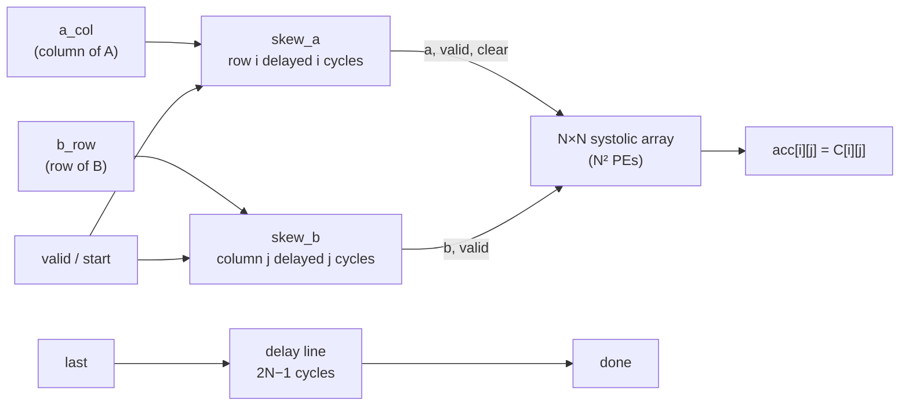

# ai-rtl: int8 Systolic Array Matrix Multiplier

A parameterised **N×N output-stationary systolic array** in SystemVerilog that computes **C = A × B** on signed 8-bit inputs with 32-bit accumulators, the core operation of neural-network accelerators such as Google's TPU.

You feed plain matrices one column of A and one row of B per cycle; the hardware skews the inputs, streams them through N² multiply-accumulate units, and raises `done` the cycle the result is ready. Verified in simulation for N = 2 to 8 with random data, varying matrix lengths, idle cycles in the input stream and back-to-back matrices.

## Block diagram



Inside the array, `a` values move right and `b` values move down, one PE per cycle. Each PE multiplies the pair passing through it and keeps its own running sum:

```
            b[0]       b[1]       b[2]       b[3]
             ▼          ▼          ▼          ▼
a[0] ──►  PE(0,0) ──► PE(0,1) ──► PE(0,2) ──► PE(0,3)
             ▼          ▼          ▼          ▼
a[1] ──►  PE(1,0) ──► PE(1,1) ──► PE(1,2) ──► PE(1,3)
             ▼          ▼          ▼          ▼
a[2] ──►  PE(2,0) ──► PE(2,1) ──► PE(2,2) ──► PE(2,3)
             ▼          ▼          ▼          ▼
a[3] ──►  PE(3,0) ──► PE(3,1) ──► PE(3,2) ──► PE(3,3)

PE(i,j) accumulates C[i][j] = Σk A[i][k] · B[k][j]
```

## Features

- **Parameterised size N** (tested N = 2, 3, 4, 8), built with `generate` loops
- **Any inner dimension K:** an N×N array computes (N×K) × (K×N) for any K; the 32-bit accumulator has headroom for very long sums
- **Signed int8 × int8 → int32** multiply-accumulate in every PE
- **Hardware input skewing:** the array takes unskewed columns and rows straight from memory
- **Valid signals travel with the data:** idle cycles (bubbles) anywhere in the input are ignored
- **Per-row clear travelling with the data:** matrices can be streamed back to back with no gap
- **`done` signal:** pulses exactly 2N−1 cycles after the last column, on the first cycle all results are final
- **Area-aware registers:** control signals (valid, start, done) have async reset; data-path delay registers do not, since their valid bit marks them as unused

## Top-level interface: `complete_sa`

| Port | Dir | Width | Description |
| --- | --- | --- | --- |
| `clk` | in | 1 | Clock |
| `rst_n` | in | 1 | Asynchronous reset, active low |
| `a_col` | in | `[N-1:0][7:0]` | Column k of A: `a_col[i] = A[i][k]` |
| `b_row` | in | `[N-1:0][7:0]` | Row k of B: `b_row[j] = B[k][j]` |
| `valid` | in | 1 | This cycle's column/row is real data |
| `start` | in | 1 | First column of a new matrix (starts fresh sums) |
| `last` | in | 1 | Last column of the matrix |
| `done` | out | 1 | One-cycle pulse when every result is final |
| `acc` | out | `[N-1:0][N-1:0][31:0]` | `acc[i][j] = C[i][j]` (signed) |

**Usage:** on each cycle, drive one column of A and the matching row of B with `valid = 1`. Set `start = 1` on the first column and `last = 1` on the last (both on the same cycle if K = 1). Wait for `done`, then read `acc`.

## How it works

**Dataflow (output-stationary).** Each PE keeps one element of C. Row i of A enters from the left and moves right; column j of B enters from the top and moves down. Every PE forwards its inputs to its neighbours through registers, one cycle per hop.

**Skewing.** Data reaching PE(i,j) has passed through j PEs horizontally and i PEs vertically, so the `a` and `b` paths have different delays. To line them up, row i of A enters i cycles late and column j of B enters j cycles late. Both then reach PE(i,j) after i + j cycles, so the k-th product happens on cycle **k + i + j**. The skew module implements this with shift registers: lane i has exactly i registers, N(N−1)/2 per side.

For N = 2, the inputs reaching the array look like this:

| Cycle | Row 0 | Row 1 | Column 0 | Column 1 |
| --- | --- | --- | --- | --- |
| 0 | A00 | – | B00 | – |
| 1 | A01 | A10 | B10 | B01 |
| 2 | – | A11 | – | B11 |

**Valid and clear.** Each value carries a valid bit; a PE only accumulates when both its inputs are valid, so empty slots in the skew pattern and idle cycles in the input are ignored. The `start` signal is skewed into one clear per row and travels right with `a`, so it reaches PE(i,j) exactly when that PE's first product of a new matrix arrives (clear-and-load in one cycle). A single global clear would instead force a pause between matrices.

**Timing.** For a matrix with K columns fed on cycles 0 … K−1:

| Quantity | Value |
| --- | --- |
| Last product in PE(N−1, N−1) | cycle K + 2N − 3 |
| `done` after the last column | 2N − 1 cycles = (N−1) skew + (N−1) PE hops + 1 accumulate |
| First column to `done` | K + 2N − 2 cycles |
| Peak throughput | N² multiply-accumulates per cycle |

## Modules

| File | Module | Description |
| --- | --- | --- |
| [`rtl/mac.sv`](rtl/mac.sv) | `mac8` | Signed int8 multiply-accumulate with 32-bit accumulator, `valid` and `clear` |
| [`rtl/pe.sv`](rtl/pe.sv) | `pe8` | Processing element: `mac8` plus registers that forward a, b, valid and clear to neighbours |
| [`rtl/sa2x2.sv`](rtl/sa2x2.sv) | `sa2x2` | 2×2 array wired by hand (first step towards N×N) |
| [`rtl/saNxN.sv`](rtl/saNxN.sv) | `systolic_array` | Parameterised N×N array built with nested `generate` loops |
| [`rtl/skew.sv`](rtl/skew.sv) | `skew` | Input skewing: lane i delayed by i cycles, with valid and start |
| [`rtl/sa_top.sv`](rtl/sa_top.sv) | `complete_sa` | Top level: two skew modules, the array and the `done` delay line |

## Verification

Every testbench is self-checking: it computes the expected result with a reference model in the testbench and prints PASS or FAIL. Results below are with Icarus Verilog 12 at the default size N = 4.

| Testbench | Covers | Result |
| --- | --- | --- |
| [`tb/tb_mac.sv`](tb/tb_mac.sv) | Directed accumulate test | PASS |
| [`tb/tb_pe.sv`](tb/tb_pe.sv) | Reset, forwarding, valid gating, 5000 random cycles | PASS (5010 checks) |
| [`tb/tb_sa2x2.sv`](tb/tb_sa2x2.sv) | 6 directed matrices + 1000 random, skew done in testbench | PASS (1006 multiplications) |
| [`tb/tb_asNxN.sv`](tb/tb_asNxN.sv) | Identity, K = 1, extreme values, back-to-back, 500 random with varying K | PASS (555 multiplications) |
| [`tb/tb_skew.sv`](tb/tb_skew.sv) | Reset with inputs active, counting pattern, 2000 random cycles | PASS (8036 checks) |
| [`tb/tb_sa_top.sv`](tb/tb_sa_top.sv) | Full chain from unskewed input: directed, bubbles with junk data, back-to-back, 500 random; exact `done` timing | PASS (605 multiplications, 562 bubble cycles) |

The N×N, skew and top-level testbenches also pass at N = 2, 3 and 8. Each testbench was checked against deliberately broken versions of the design (wrong wiring, missing reset, misaligned valid, clear not travelling with the data, `done` one cycle late) to make sure it catches real bugs.

## Running the tests

Requires [Icarus Verilog](https://steveicarus.github.io/iverilog/) 12 or newer. From the repository root:

```bash
# Full system (skew + array + done)
iverilog -g2012 -o sim.vvp rtl/mac.sv rtl/pe.sv rtl/saNxN.sv rtl/skew.sv rtl/sa_top.sv tb/tb_sa_top.sv
vvp sim.vvp

# Individual blocks
iverilog -g2012 -o sim.vvp rtl/mac.sv tb/tb_mac.sv && vvp sim.vvp
iverilog -g2012 -o sim.vvp rtl/mac.sv rtl/pe.sv tb/tb_pe.sv && vvp sim.vvp
iverilog -g2012 -o sim.vvp rtl/mac.sv rtl/pe.sv rtl/sa2x2.sv tb/tb_sa2x2.sv && vvp sim.vvp
iverilog -g2012 -o sim.vvp rtl/mac.sv rtl/pe.sv rtl/saNxN.sv tb/tb_asNxN.sv && vvp sim.vvp
iverilog -g2012 -o sim.vvp rtl/skew.sv tb/tb_skew.sv && vvp sim.vvp
```

Other sizes and random seeds:

```bash
iverilog -g2012 -Ptb_complete_sa.N=8 -o sim.vvp rtl/*.sv tb/tb_sa_top.sv
vvp sim.vvp +seed=42
```

## Repository layout

```
rtl/    design files
tb/     self-checking testbenches
```

## Limitations and next steps

- **Results are only all present between matrices.** In back-to-back streaming, early PEs start the next matrix before the last PE finishes, so `done` assumes a gap before the next `start`. Next step: copy results to an output buffer on `done` (double buffering).
- **N² × 32 output wires.** Fine for small N, impractical for large arrays. Next step: shift results out one row per cycle.
- **Single-cycle MAC.** Multiply and add in the same cycle will set the critical path; pipelining the MAC would raise the clock frequency.
- **No synthesis numbers yet.** Next step: area and maximum frequency versus N using sv2v + Yosys.
- **Capstone:** run an int8-quantised MNIST layer from PyTorch on the array in simulation and compare against the PyTorch result.

## AI use

- **Design (RTL):** all design files in `rtl/` were written by me. Claude reviewed them, explained concepts and pointed out bugs, which I then fixed.
- **Testbenches:** `tb/tb_mac.sv` was written by me. The other testbenches were generated by Claude and run against my designs.
- **Documentation:** this README was drafted with Claude.

## Tools

- SystemVerilog (IEEE 1800-2012)
- Icarus Verilog 12 for simulation
